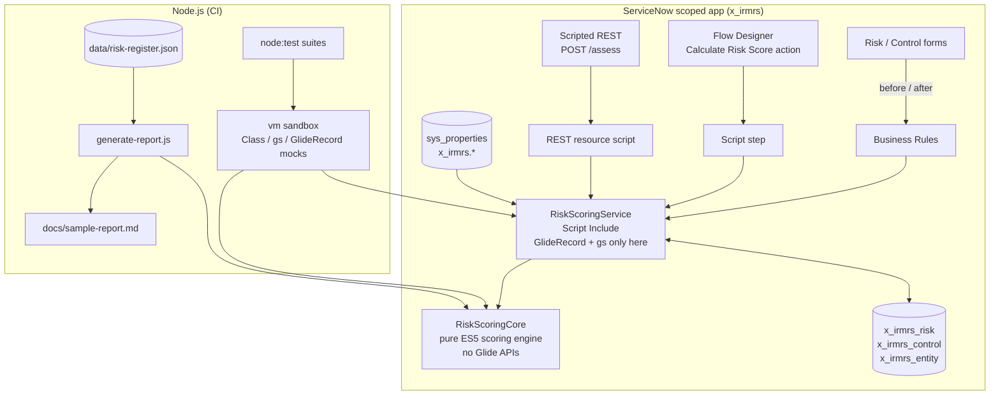

# servicenow-irm-risk-scoring

[](https://github.com/akramservicenow-sketch/servicenow-irm-risk-scoring/actions/workflows/ci.yml)


[](LICENSE)

A configurable **risk scoring engine for ServiceNow scoped applications**, written as Script Includes in
the `Class.create()` pattern. It calculates inherent risk on a likelihood x impact matrix, weights
controls by design and operating effectiveness, derives residual risk, compares it with risk appetite
and tolerance, rolls risks up to entities, and schedules the next review. The concepts follow
**ISO 31000** and **NIST SP 800-30**.

The scoring logic is a **platform-independent module** with no Glide APIs. Thin ServiceNow wrappers
(Script Include, Business Rules, a Flow Designer action step and a Scripted REST resource) handle all
record access, so the maths can be unit-tested in Node.js.

> **Disclaimer:** This is an independent, representative portfolio project built with synthetic data; not code from any employer or client. All entities, risks, controls and identifiers are fictional.

---

## Contents

- [Business problem](#business-problem)
- [Scoring model](#scoring-model)
- [Architecture](#architecture)
- [Repository layout](#repository-layout)
- [Install into a PDI](#install-into-a-personal-developer-instance-pdi)
- [Configuration (system properties)](#configuration-system-properties)
- [Using the engine](#using-the-engine)
- [Tests](#tests)
- [Sample report](#sample-report)
- [Security notes](#security-notes)
- [Limitations](#limitations)
- [Roadmap](#roadmap)

## Business problem

Risk teams often score risks in spreadsheets or with scripts copied from record to record. This causes
recurring problems:

- **Inconsistent scoring:** different teams multiply, average or "judge" scores differently, so a
  "High" in one business unit is not comparable with a "High" in another.
- **Controls without effect:** control testing results (design and operating effectiveness) are
  recorded but not reflected in residual risk.
- **Appetite stays on paper:** the board-approved appetite statement is not checked against actual
  residual scores, so breaches are found late.
- **Review cycles drift:** critical risks should be reviewed far more often than low ones, but review
  dates are set by hand.
- **Untestable logic:** scoring code embedded in Business Rules cannot be unit-tested, so every
  methodology change is risky.

This project implements one documented, configurable methodology, keeps it in a single tested module,
and applies it consistently from forms, flows and integrations.

## Scoring model

### 1. Inherent risk

Likelihood (L) and impact (I) are rated on 1-5 scales (labels and size are configurable):

| Level | Likelihood | Impact |
|------:|------------|--------|
| 1 | Rare | Insignificant |
| 2 | Unlikely | Minor |
| 3 | Possible | Moderate |
| 4 | Likely | Major |
| 5 | Almost Certain | Severe |

```
InherentScore = M[L][I]        default M[L][I] = L x I   (range 1..25)
```

An explicit matrix can replace `L x I`, for example to weight impact more heavily than likelihood.
The engine validates that it has the right dimensions and **never decreases** as L or I increases.

Default 5x5 matrix (band in brackets):

| L \ I | 1 | 2 | 3 | 4 | 5 |
|------:|:-:|:-:|:-:|:-:|:-:|
| **5** | 5 (M) | 10 (H) | 15 (H) | 20 (C) | 25 (C) |
| **4** | 4 (L) | 8 (M) | 12 (H) | 16 (H) | 20 (C) |
| **3** | 3 (L) | 6 (M) | 9 (M) | 12 (H) | 15 (H) |
| **2** | 2 (L) | 4 (L) | 6 (M) | 8 (M) | 10 (H) |
| **1** | 1 (L) | 2 (L) | 3 (L) | 4 (L) | 5 (M) |

### 2. Control effectiveness

Each control has a **design** rating and an **operating** rating:

| Rating | Factor |
|--------|-------:|
| `effective` | 1.00 |
| `largely_effective` | 0.75 |
| `partially_effective` | 0.50 |
| `ineffective` | 0.00 |
| `not_tested` | 0.00 |

```
E_control = wD x D + wO x O          defaults wD = 0.4, wO = 0.6 (must sum to 1)
E_control = 0  if D = 0               (design gate: a badly designed control cannot operate well)
```

Multiple active controls are combined. The default `complement` method treats controls as independent
layers of defence:

```
E_combined = 1 - PRODUCT(1 - E_i)     (alternatives: max(E_i), average(E_i))
E_applied  = min(E_combined, maxReduction)       default maxReduction = 0.8
```

The cap reflects that controls can fail. Without it, a few strong controls would push residual risk
close to zero.

### 3. Residual risk

```
ResidualScore = max(minCell, InherentScore x (1 - E_applied))    rounded to 2 decimals
```

### 4. Rating bands

Bands are defined by an inclusive upper bound, so fractional residual scores map unambiguously:

| Band | Score range | Default review interval |
|------|-------------|------------------------:|
| Low | <= 4 | 365 days |
| Moderate | > 4 and <= 9 | 180 days |
| High | > 9 and <= 16 | 90 days |
| Critical | > 16 and <= 25 | 30 days |

### 5. Appetite and tolerance

```
Residual <= appetite              -> Within Appetite
appetite < Residual <= tolerance  -> Within Tolerance   (accepted, but monitored or escalated)
Residual > tolerance              -> Exceeds Tolerance  (treatment required)
```

The defaults are appetite 6 and tolerance 12. Thresholds can be overridden by category
(e.g. a lower appetite for Cyber or Compliance).

### 6. Entity roll-up

| Method | Formula | Use when |
|--------|---------|----------|
| `max` (default) | max(Residual_i) | "Worst risk drives the entity rating" (conservative) |
| `weighted_average` | SUM(w_i x R_i) / SUM(w_i) | Portfolio view; `weight` defaults to 1 |
| `average` | SUM(R_i) / n | Simple comparisons |

The result includes the **driver** (the risk with the highest residual score).

### 7. Review due date

```
NextReview = AssessmentDate + ReviewInterval[ResidualRating]
```

The calculation uses calendar-correct UTC date arithmetic (leap years, month ends). The interval
depends on the residual rating.

### Worked example

L = 4, I = 5, so the inherent score is 20 (Critical). There is one control with design `effective`
and operating `partially_effective`: E = 0.4 x 1 + 0.6 x 0.5 = 0.70. The residual score is
20 x 0.30 = **6 (Moderate)**, which is within the default appetite of 6. The next review is in
180 days.

### Relationship to ISO 31000 and NIST SP 800-30

| Concept | Where it appears |
|---------|------------------|
| ISO 31000 risk criteria (6.3.4) | Configurable scales, matrix, bands, appetite and tolerance |
| ISO 31000 risk analysis and evaluation (6.4.3-6.4.4) | Inherent/residual scoring, appetite status |
| ISO 31000 monitoring and review (6.6) | Review due date by rating |
| NIST SP 800-30 likelihood x impact determination | Semi-quantitative 5-level scales and matrix |
| NIST SP 800-30 security controls in the risk model | Control effectiveness reduces residual risk |

This is a practical implementation **inspired by** these frameworks, not a certified or complete
implementation of either.

## Architecture



**Design choices**

- **Pure core, thin wrappers.** `RiskScoringCore` takes plain values and returns plain objects. Only
  `RiskScoringService` touches `GlideRecord`/`gs`, so the methodology can be tested without an instance.
- **No `current.update()`.** The before rule sets values on `current`. Other records are saved
  through the service, which avoids the recursion anti-pattern.
- **Fail closed on bad input.** Validation errors abort the save with a user-facing message. A bad
  configuration property is logged and ignored, so it does not block every save.
- **ES5 only** in platform code, so the scripts run in both compatibility mode and ES2021 mode. A test
  enforces this.

## Repository layout

```
src/
  core/RiskScoringCore.js                       platform-independent engine (Script Include body)
  servicenow/
    script_includes/RiskScoringService.js       GlideRecord wrapper
    business_rules/risk_calculate_scores.js     before insert/update on x_irmrs_risk
    business_rules/control_rescore_risk.js      after insert/update/delete on x_irmrs_control
    business_rules/risk_rollup_entity.js        after insert/update/delete on x_irmrs_risk
    flow_actions/calculate_risk_score_step.js   Flow Designer action script step
    scripted_rest/assess_resource.js            POST /api/x_irmrs/risk_scoring/assess
config/scoring-config.example.json              template for the x_irmrs.scoring_config property
data/risk-register.json                         synthetic register (16 risks, 4 entities)
scripts/generate-report.js                      heat map / register report generator
scripts/lib/load-core.js                        loads the core into Node with a Class shim
test/                                           node:test suites
test-support/sn-runtime.js                      vm-based ServiceNow runtime and mocks
docs/sample-report.md                           generated report
```

## Install into a Personal Developer Instance (PDI)

The steps below build the app by hand in Studio. No pre-built update set XML is shipped: a hand-written
package is easy to get subtly wrong, and building it yourself shows exactly what each piece does. Once
built, the app can be linked to this repository through Studio source control or exported as an update
set.

> **Scope name:** PDIs often add a vendor prefix to new scopes (for example `x_123456_irmrs`). If your
> scope differs from `x_irmrs`, replace `x_irmrs` in the property names, the Flow step and the REST
> resource accordingly.

1. **Get a PDI** from the ServiceNow Developer Program and log in as an admin.
2. **Create the application.** Open Studio (*System Applications > Studio*, or ServiceNow Studio on
   newer releases) and create an application named **IRM Risk Scoring** with scope **`x_irmrs`**.
3. **Create roles:** `x_irmrs.risk_analyst` (read and run assessments) and `x_irmrs.risk_manager`
   (contains `risk_analyst`, and can edit risks, controls and configuration).
4. **Create tables** (*Data Model > Table*):

   | Table | Fields |
   |-------|--------|
   | `x_irmrs_entity` | `name` (String), `aggregate_score` (Decimal), `aggregate_rating` (String), `risk_count` (Integer), `aggregate_driver` (Reference: x_irmrs_risk) |
   | `x_irmrs_risk` | `short_description` (String), `entity` (Reference: x_irmrs_entity), `category` (Choice), `likelihood` (Integer, choices 1-5), `impact` (Integer, choices 1-5), `weight` (Decimal, default 1), `active` (True/False, default true), `inherent_score` (Decimal), `inherent_rating` (String), `control_effectiveness` (Decimal), `residual_score` (Decimal), `residual_rating` (String), `appetite_status` (String), `next_review_date` (Date) |
   | `x_irmrs_control` | `name` (String), `risk` (Reference: x_irmrs_risk), `design_effectiveness` (Choice: effective, largely_effective, partially_effective, ineffective), `operating_effectiveness` (Choice: same values plus not_tested), `active` (True/False, default true) |

   Make the calculated fields read-only in the dictionary (or with a UI policy and write ACLs).
5. **Create Script Includes** (*Server Development > Script Include*). For both, set Accessible from
   to *This application scope only* and leave Client callable unchecked.
   - `RiskScoringCore`: paste [`src/core/RiskScoringCore.js`](src/core/RiskScoringCore.js).
   - `RiskScoringService`: paste [`RiskScoringService.js`](src/servicenow/script_includes/RiskScoringService.js).
6. **Create system properties** (see [Configuration](#configuration-system-properties)). At minimum,
   create `x_irmrs.scoring_config` (type *string*, value `{}` or the JSON from
   [`config/scoring-config.example.json`](config/scoring-config.example.json)). Restrict write access to
   `x_irmrs.risk_manager`.
7. **Create Business Rules** (*Server Development > Business Rule*, Advanced checked) from
   [`src/servicenow/business_rules/`](src/servicenow/business_rules). The table, timing, operations and
   condition for each rule are in the comment header of its file.
8. **Create the Flow Designer action** *Calculate Risk Score*: add an input `risk_sys_id` (String), add
   a **Script step** with the same input, paste
   [`calculate_risk_score_step.js`](src/servicenow/flow_actions/calculate_risk_score_step.js), declare the
   outputs listed in its header, and map them to action outputs. Publish the action.
9. **Create the Scripted REST API** *Risk Scoring* (API ID `risk_scoring`), add a resource `POST /assess`
   with [`assess_resource.js`](src/servicenow/scripted_rest/assess_resource.js), and tick *Requires
   authentication* and *Requires ACL authorization*.
10. **Create ACLs** (see [Security notes](#security-notes)).
11. **Smoke test.**
    - Create an entity, then a risk with L = 4 and I = 5. On save, the inherent score should be 20
      (Critical) and the residual score 20 (no controls yet).
    - Add a control (`effective` / `partially_effective`). The risk should be rescored to a residual of
      6 (Moderate), and the entity aggregate should update.
    - In *REST API Explorer*, call `POST /api/x_irmrs/risk_scoring/assess` with
      `{"likelihood":4,"impact":5,"controls":[{"design":"effective","operating":"partially_effective"}]}`.
12. **Keep the work.** Link the app to a Git repository (Studio *Source Control*), or publish it as an
    update set and export the XML.

## Configuration (system properties)

| Property | Type | Default | Purpose |
|----------|------|---------|---------|
| `x_irmrs.scoring_config` | string (JSON) | `{}` | Partial override of the scoring model, merged over the defaults and validated on load |
| `x_irmrs.entity_aggregation` | string | `max` (from config) | `max`, `weighted_average` or `average` for entity roll-up |
| `x_irmrs.risk_table` | string | `x_irmrs_risk` | Risk table name (for example, to point at a table extension) |
| `x_irmrs.control_table` | string | `x_irmrs_control` | Control table name |
| `x_irmrs.entity_table` | string | `x_irmrs_entity` | Entity table name |

Example `x_irmrs.scoring_config` value ([template](config/scoring-config.example.json)):

```json
{
  "appetite": { "appetite": 6, "tolerance": 12 },
  "appetiteByCategory": { "Cyber": { "appetite": 4, "tolerance": 9 } },
  "designWeight": 0.4,
  "operatingWeight": 0.6,
  "controlAggregation": "complement",
  "maxReduction": 0.8,
  "reviewIntervalDays": { "Low": 365, "Moderate": 180, "High": 90, "Critical": 30 }
}
```

All configurable keys: `likelihoodLabels`, `impactLabels`, `matrix`, `bands`, `effectivenessRatings`,
`designWeight`, `operatingWeight`, `designGate`, `controlAggregation`, `maxReduction`, `appetite`,
`appetiteByCategory`, `reviewIntervalDays`, `entityAggregation`, `scoreDecimals`. Unknown keys and
inconsistent values (weights that do not sum to 1, bands that do not cover the matrix, tolerance below
appetite, a decreasing matrix, and so on) are rejected. If the property contains invalid JSON, the
service logs an error and uses the defaults.

## Using the engine

```javascript
// Server-side script in scope x_irmrs
var svc = new RiskScoringService();
var result = svc.scoreRisk(riskSysId);          // score and save one risk
svc.rollUpEntity(entitySysId, 'weighted_average');

var whatIf = svc.whatIf({ likelihood: 3, impact: 4,
    controls: [{ design: 'effective', operating: 'largely_effective' }] });
gs.info('Residual {0} ({1}), review by {2}', whatIf.residual.score, whatIf.residual.rating, whatIf.reviewDueDate);

// Pure engine, no records involved
var core = new RiskScoringCore({ maxReduction: 0.7 });
core.assess({ likelihood: 4, impact: 5, controls: [], assessedOn: '2026-01-15' });
```

`assess()` returns:

```json
{
  "id": "RSK-001", "category": "Cyber",
  "inherent": { "likelihood": 4, "impact": 5, "likelihoodLabel": "Likely", "impactLabel": "Severe", "score": 20, "rating": "Critical" },
  "controlEffectiveness": { "raw": 0.7, "applied": 0.7, "count": 1, "method": "complement" },
  "residual": { "score": 6, "rating": "Moderate" },
  "appetite": { "status": "Within Appetite", "appetite": 6, "tolerance": 12 },
  "reviewDueDate": "2026-07-14"
}
```

## Tests

```bash
npm test          # node:test, no dependencies (Node 18+)
npm run report    # regenerate docs/sample-report.md
```

There are **50 tests**:

- **Core (27):** matrix and band boundaries, numeric-string inputs, the design gate, all aggregation
  methods, the reduction cap, residual floor, category appetite, leap-year and month-end review dates,
  entity roll-up edge cases (empty, zero weights, unknown method), custom 4x4 and 5x5 matrices, heat map
  counts, and 12 configuration validation cases.
- **ServiceNow wrappers (16):** the Script Include, all three Business Rules (including abort on invalid
  input and rescoring the previous parent), the Flow step outputs and failures, and the REST resource
  (200 / 400 / 403, no record access for what-if). These run the **unmodified platform scripts** inside
  a `node:vm` sandbox with lightweight `Class`, `gs`, `GlideRecord`, `GlideDate` and `sn_ws_err` mocks
  ([`test-support/sn-runtime.js`](test-support/sn-runtime.js)).
- **Platform compatibility (7):** every platform script is checked for ES2015+ syntax and APIs, and for
  `gs.log`, `current.update()` and `eval()`. The core is also checked for Glide API usage.

CI runs the suite on Node 18 and 20, and fails if the committed sample report is out of date.

## Sample report

[`docs/sample-report.md`](docs/sample-report.md) is generated from the synthetic register. It includes
a text heat map, the inherent vs residual rating distribution, appetite breaches, the full register,
and entity roll-ups. An excerpt:

```text
                      1 Insignificant  2 Minor          3 Moderate       4 Major          5 Severe
5 Almost Certain      M 5              H10              H15              C20              C25
4 Likely              L 4              M 8 [1]          H12 [1]          H16 [1]          C20 [1]
3 Possible            L 3              M 6              M 9 [2]          H12 [2]          H15 [2]
2 Unlikely            L 2              L 4              M 6 [1]          M 8 [2]          H10 [2]
1 Rare                L 1              L 2 [1]          L 3              L 4              M 5
```

## Security notes

- **ACLs.** Create table ACLs so that `x_irmrs.risk_analyst` can read and `x_irmrs.risk_manager` can
  write risks, controls and entities. Add **field-level write ACLs that deny writes** to calculated
  fields (`inherent_*`, `residual_*`, `control_effectiveness`, `appetite_status`, `next_review_date`,
  `aggregate_*`), so scores can only come from the engine.
- **REST.** The resource requires authentication and ACL authorization (a `REST_Endpoint` ACL for
  `x_irmrs.risk_analyst`). The script repeats the role check, copies only the expected fields from the
  body, limits the number of controls, returns 400 for validation errors, and does not leak stack traces.
- **Scoped privileges.** Everything runs inside `x_irmrs`, and both Script Includes are *This
  application scope only*. If you point the property-driven table names at tables in another scope
  (for example a GRC table), grant only the specific **cross-scope privileges** needed (read/write on
  those tables) and review them in *System Applications > Application Cross-Scope Access*. Keep
  runtime access tracking on *Tracking* or *Enforcing*.
- **Configuration integrity.** Restrict write access on `x_irmrs.*` properties to risk managers or
  admins. Methodology changes alter every score, so treat them as controlled changes.
- **No dynamic code.** No `eval`, no `GlideEvaluator`, and no client-callable Script Includes. Inputs
  are validated with strict ranges before use.
- **Logging** uses scoped `gs.info/warn/error` and does not log record contents.

## Limitations

- **Not a replacement for ServiceNow IRM.** This is a focused scoring library. It does not replace
  ServiceNow Integrated Risk Management, its **Advanced Risk Assessment** engine (assessment templates,
  factor-based questionnaires, approval workflow, assessment history), or its policy, issue and control
  testing modules. It is useful as a reference implementation, for custom apps that need consistent
  scoring, or as a way to prototype a methodology before configuring it in IRM.
- **Semi-quantitative model.** Scores are ordinal-scale products, not monetary or probabilistic
  estimates. No Monte Carlo simulation, loss distributions or FAIR-style quantification.
- **Independence assumption.** The complement method assumes controls fail independently. Use `max`
  when controls overlap.
- **Single-level roll-up.** Entities are not nested, so there is no hierarchy aggregation or
  correlation between risks.
- **No assessment history or audit trail** beyond the platform's field auditing. Enable auditing on
  the risk table if you need it.
- The Node mocks implement only the Glide API surface used here. They are not a general ServiceNow
  emulator.

## Roadmap

- [ ] Target-risk scoring and treatment-plan tracking (planned controls with due dates)
- [ ] Hierarchical entity roll-up with configurable weights per level
- [ ] Key risk indicators (KRIs) that adjust likelihood from metric thresholds
- [ ] Scheduled job for a nightly full re-score and overdue-review notifications
- [ ] Optional quantitative mode (annualised loss expectancy ranges)
- [ ] ATF test suite for on-instance regression testing
- [ ] Service Portal / UI Builder heat map component

## License

[MIT](LICENSE) © 2026 Shaik Akram
